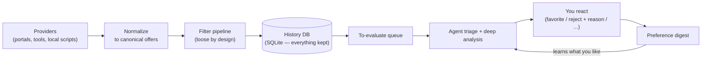

# housing-ops

**Your own housing-search engine — an LLM-driven helper for renting or buying a home.**

You open this repo in your AI assistant (opencode, Claude Code, …) and talk to it like a colleague:
*"find me a 2-bed in Dublin under €2,200 with a garden."*
It configures itself, scans property portals on a schedule, filters every listing
through a pipeline you control, and hands you a shortlist —
learning what you like from every reaction you give it.

> **Status:** housing-ops is in design. This README describes the system we're
> building; the implementation follows the design in `docs/DECISIONS.md`.

## The problem

House-hunting is a pipeline problem. Dozens of new listings appear every day
across several portals, most of them irrelevant, a few of them gone within
hours. Portals give you saved searches and email alerts — blunt instruments
with no memory, no judgment, and no way to say *"not that one, and here's why."*

housing-ops gives you a search that remembers: every listing it has ever seen,
every verdict it has ever made, and everything you have ever told it about
what you like.

## How it works

1. **Providers fetch listings.** Pluggable adapters pull from property portals —
   Daft, MyHome, Rent.ie in Ireland, whatever you add for your country. A
   provider can be an external tool (e.g. a Python scraper), a small script, or
   a plain HTTP feed. Anything that emits our listing JSON can be a provider.
2. **A filter pipeline narrows them down.** Location, budget, layout, bedrooms,
   size, floor, age, BER rating, must-haves, red flags — ordered, configurable,
   and deliberately **loose**. We don't try to be clever here; we try not to
   miss anything.
3. **Everything is stored.** Every listing, whether it passed or failed, lands
   in a small local database with the verdict attached. Rejections are data:
   they're how the system learns.
4. **The agent reads the survivors.** In a session with your AI assistant, it
   triages the queue (cheap pass: keep / reject / hold), then analyses what it
   kept in depth — against your profile, against comparable listings it has
   seen before, checking for red flags — and records a structured verdict.
5. **You react, it learns.** Viewed, favorited, rejected (*with a reason*),
   viewing requested. Your reactions plus your stated preferences feed a
   digest the agent consults every time it evaluates a listing or proposes a
   change to your search.



Run `housing-ops scan` on a schedule and the deterministic half runs with zero
AI cost. Open the repo in your assistant and say *"what's new?"* for the other
half.

## How it's built

- **Deterministic core, no LLM inside.** The core is a typed TypeScript
  application — offer domain, pipeline engine, storage — with no AI calls in
  it at all. It is testable, headless-runnable, and cheap: scanning costs
  nothing but bandwidth.
- **Your AI assistant is the interface.** All judgment, conversation, and
  code-writing (new providers, new filters) happens in your harness, which
  drives the core through structured commands. Tomorrow the same core can be
  driven by our own app or a REST API — the interface is swappable, the core
  is not.
- **Composable by design.** Four extension points, each a drop-in module:
  **providers** (where listings come from), **filters** (how they're judged),
  **publishers** (where matches go — a webhook today, Telegram later),
  **storage** (SQLite by default; plug in anything, including cloud databases).
  You can even author new filters by *describing* them to the agent.
- **History-preserving.** The database keeps every listing considered and every
  decision made about it. That history is what lets the agent understand your
  taste instead of re-asking you every week.

Hexagonal, in short: a pure core with ports, adapters around it, and the LLM
kept firmly outside the hexagon.

## Inspired by career-ops

The idea owes a debt to
[career-ops](https://github.com/career-ops-hq/career-ops), a job-hunting
co-pilot with the same spirit: personal, local-first, agent-driven search.
We keep its best instincts — a zero-cost deterministic scan tier, a provider
module contract, human-in-the-loop guarantees — and fix what made it hard to
customize: instead of prompt files plus loose scripts with files as the
database, housing-ops is a real typed application with a database as the
source of truth and the AI as a replaceable interface.

## Quickstart

```bash
git clone <this-repo> housing-ops
cd housing-ops
npm install
housing-ops setup        # or: open the repo in your assistant and say "set me up"
```

Setup is a conversation: country (Ireland by default), rent or buy, budget,
areas, must-haves, deal-breakers, which providers to enable. It writes your
config and initializes the database. Then:

```bash
housing-ops scan         # fetch → filter → store (deterministic, zero AI cost)
```

…and in your assistant: *"what's new?"* — it triages the queue, analyses the
keepers, and shows you the shortlist.

## Layout

```text
src/core/        offer domain + pipeline engine (pure, tested)
src/api/         versioned command surface the interfaces drive
src/cli/         thin `housing-ops` wrapper (JSON in/out)
providers/       bundled provider adapters      (+ providers.local/ for yours)
filters/         bundled filters                (+ filters.local/ for yours)
publishers/      bundled publishers             (+ publishers.local/ for yours)
storage/         storage adapters (SQLite default)
agent-flows/     agent flow definitions (onboarding, triage, authoring, …)
config/          profile.yml, pipeline.yml, providers.yml, extensions.yml
data/            housing.db (gitignored) — your history lives here
docs/            decisions, ADRs, design notes
tests/
```

## Extending housing-ops

- **Add a provider:** point `providers.yml` at any external command that emits
  listing JSON, or drop a module in `providers.local/`. Approve it once; the
  core pins and verifies it from then on.
- **Add a filter:** describe it to your assistant — it writes the module,
  dry-runs it against listings you already have, and asks for approval.
- **Add a publisher:** implement `publish(event, payload)`; subscribe to
  `offer.passed`, `offer.updated` (e.g. price drops), or `offer.judged`.
- **Swap storage:** implement the store port; SQLite stays the default.

User-authored extensions are approved explicitly and hash-pinned — if a pinned
file changes, the core refuses to load it until you re-approve.

## Defaults: Ireland

Out of the box: Daft + MyHome + Rent.ie, euro pricing, Eircode-aware
addresses, BER-rating filter. Portals change their sites and their terms, so
bundled providers are thin, paced, and replaceable — the machinery is the
product.

## Scraping & fair use

housing-ops is a personal-use tool. Bundled providers are rate-limited by
default, never circumvent bot protection (if a portal walls itself off, the
provider reports degraded health instead), and you are responsible for
complying with each portal's terms. If the terms don't allow it, don't point
it at them.

## Roadmap

- v1: deterministic backend + harness interface (this README's core)
- Later: our own frontend over the same command surface, with its own AI
  integration — same experience, no third-party assistant required
- Later: richer publishers (Telegram, …), more countries' default providers

## License

MIT. Your data (`data/`, `config/`) is yours and never leaves your machine
unless you attach a publisher that sends it somewhere.
