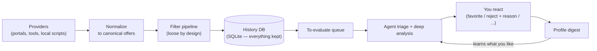

# housing-ops

**Your own housing-search engine — an LLM-driven helper for renting or buying a home.**

You open this repo in your AI assistant (opencode, Claude Code, …) and talk to it like a colleague:
*"find me a 2-bed in Dublin under €2,500 with a garden."*
It configures itself, scans property portals, filters
every listing through a pipeline you control, and hands you a shortlist —
learning what you like from every reaction you give it.

> **Status:** v1. The deterministic core — providers, filters, storage, the
> judgement loop, and publishers — is built and tested. It ships the machinery,
> **not the portals**: you add a provider for your portal before the first scan
> returns anything. See `AGENTS.md` and `docs/design/`.

## The problem

House-hunting is a pipeline problem. Dozens of new listings appear every day
across several portals, most of them irrelevant, a few of them gone within
hours. Portals give you saved searches and email alerts — blunt instruments
with no memory, no judgment, and no way to say *"not that one, and here's why."*

housing-ops gives you a search that remembers: every listing it has ever seen,
every verdict it has ever made, and everything you have ever told it about
what you like.

## How it works

1. **Providers fetch listings.** Pluggable adapters pull from property portals —
   Daft, MyHome, Rent.ie in Ireland, whichever you wire for your country. A
   provider can be an external tool (e.g. a Python scraper), a small script, or
   a plain HTTP feed. Anything that emits our listing JSON can be a provider.
   The repo ships the contract and the adapters, not the providers — you add
   one with the `add-provider` flow.
2. **A filter pipeline narrows them down.** Location, budget, layout, bedrooms,
   size — ordered, configurable, and deliberately **loose**. We don't try to be
   clever here; we try not to miss anything. Country-specific facts (BER, in
   Ireland) and any rule of your own (floor, age, must-haves, red flags) arrive
   as local filters you author by *describing* them to the agent.
3. **Everything is stored.** Every listing, whether it passed or failed, lands
   in a small local database with the verdict attached. Rejections are data:
   they're how the system learns.
4. **The agent reads the survivors.** In a session with your AI assistant, it
   triages the queue (cheap pass: screened / reject / hold), then analyses what it
   kept in depth — against your profile, against comparable listings it has
   seen before, checking for red flags — and records a structured verdict.
5. **You react, it learns.** Viewed, favorited, rejected (*with a reason*),
   viewing requested. Your reactions plus your stated preferences feed a
   digest the agent consults every time it evaluates a listing or proposes a
   change to your search.



Run `housing-ops scan` on a schedule and the deterministic half runs with zero
AI cost. Open the repo in your assistant and say *"what's new?"* for the other
half.

## How it's built

- **Deterministic core, no LLM inside.** The core is a typed TypeScript
  application — offer domain, pipeline engine, storage — with no AI calls in
  it at all. It is testable, headless-runnable, and cheap: scanning costs
  nothing but bandwidth.
- **Your AI assistant is the interface.** All judgment, conversation, and
  code-writing (new providers, new filters) happens in your harness, which
  drives the core through structured commands. Tomorrow the same core can be
  driven by our own app or a REST API — the interface is swappable, the core
  is not.
- **Composable by design.** Four extension points, each a drop-in module:
  **providers** (where listings come from), **filters** (how they're judged),
  **publishers** (where matches go — any command that reads the event envelope,
  Telegram or a script), **storage** (SQLite by default; plug in anything,
  including cloud databases). You can even author new filters by *describing*
  them to the agent.
- **History-preserving.** The database keeps every listing considered and every
  decision made about it. That history is what lets the agent understand your
  taste instead of re-asking you every week.

Hexagonal, in short: a pure core with ports, adapters around it, and the LLM
kept firmly outside the hexagon.

## Inspired by career-ops

The idea owes a debt to
[career-ops](https://github.com/career-ops-hq/career-ops).

## Quickstart

```bash
git clone https://github.com/giadefz/housing-ops.git housing-ops
cd housing-ops
npm ci
npm run build
npm link           # put `housing-ops` on your PATH (or use: npm run housing-ops -- <cmd>)
```

Open the repo in your assistant and say *"set me up"* — or run
`housing-ops setup`. Setup is a conversation: country (Ireland by default), rent
or buy, budget, areas, must-haves, deal-breakers, the judgement gate. It writes
your five config files and initialises the database.

Then **add a provider** — housing-ops ships none, by design. Tell your assistant
*"write me a Daft provider"* and it follows `skills/write-provider/`: it writes a
command that emits listing JSON, adds a `providers.yml` entry, and tests it.

```bash
housing-ops provider test daft   # a capped sample, validated
```

Now you can scan, and ask:

```bash
housing-ops scan                 # fetch → filter → store (deterministic, zero AI cost)
```

…and in your assistant: *"what's new?"* — it triages the queue, analyses the
keepers, and shows you the shortlist.

## Layout

```text
src/
  composition.ts         # the composition root: wires adapters into ApplicationPort
  defaults.ts            # the bundled adapters
  core/
    domain/              # dwelling, offer, listing, country-pack — pure, zod only
    ports/               # provider, filter, store, publisher, event bus, clock
    services/            # use cases: validate, setup, scan, queue, verdict, publish…
    schemas/             # the five config files + the request contracts
    errors/              # typed errors the wire layer maps to failure codes
  adapters/
    primary/cli/         # argv, dispatch, commands/, envelope printing (entry point)
    secondary/           # workspace, storage/sqlite, providers, filters, publishers
  countries/ie/          # the Ireland pack
providers.local/  filters.local/   # yours (approved + hash-pinned in extensions.yml)
config/                  # profile, pipeline, providers, publishers, extensions (.yml)
data/                    # housing.db (gitignored) — your history lives here
docs/design/             # the contracts the agent reads
tests/
```

## Extending housing-ops

- **Add a provider:** point `providers.yml` at any external command that emits
  listing JSON, or drop a module in `providers.local/`. Approve it once; the
  core pins and verifies it from then on.
- **Add a filter:** describe it to your assistant — it writes the module,
  dry-runs it against listings you already have, and asks for approval.
- **Add a publisher:** point `publishers.yml` at any command that reads the
  event envelope on stdin; subscribe to `offer.passed`, `offer.screened`,
  `offer.shortlisted`, `offer.closed`, or `offer.updated` (price drops).
- **Swap storage:** implement the store port; SQLite stays the default.

User-authored extensions are approved explicitly and hash-pinned — if a pinned
file changes, the core refuses to load it until you re-approve.

## Defaults: Ireland

Out of the box: Ireland — euro pricing, Eircode-aware addresses, and a
BER-rating filter, with the architecture ready for any country. Portals are
user-side: Daft, MyHome, and Rent.ie are wired through the add-provider flow,
not bundled. Portals change their sites and their terms, so a shipped scraper
would break and age; the machinery is the product.

## Scraping & fair use

housing-ops is a personal-use tool. The core paces the providers you wire and
never circumvents bot protection (if a portal walls itself off, the provider
reports degraded health instead), and you are responsible for complying with
each portal's terms. If the terms don't allow it, don't point it at them.

## License

MIT — see [LICENSE](LICENSE). Your data (`data/`, `config/`) is yours and never
leaves your machine unless you attach a publisher that sends it somewhere.
