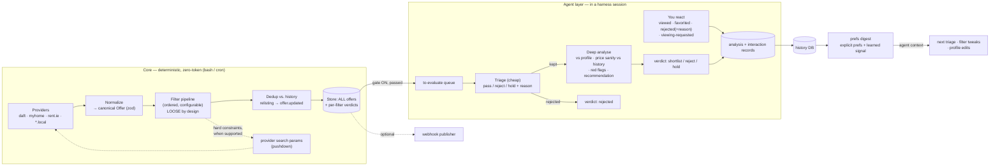

# Housing-Ops — Decision Log

Running log of every decision point from the design grilling
(method: `.agents/skills/grilling/SKILL.md`).
Settled decisions are appended under **Decisions** with context / options / choice / why.
Hard-to-reverse or surprising decisions get promoted to ADRs in `docs/adr/`
(format: `.agents/skills/domain-modeling/ADR-FORMAT.md`).

## Vision (from the user, 2026-10-03)

- LLM-based housing helper, rent or buy.
- User clones the repo, attaches one or more providers (property portals); some included by default based on country.
- Every offer flows through a composable pipeline of filters (location, budget, house layout: penthouse/apartment/etc., …) and is extensible.
- The user can build new filters by speaking to the LLM.
- Offers passing the pipeline end up in a small local database.
- Optional "publishers" attach at the end of the pipeline (Telegram bot, push to another DB, …).
- The DB stores all considered houses, including rejected ones — history + signal for the agent about what the user likes.
- Everything must be composable and customisable.
- Reference: https://github.com/career-ops-hq/career-ops (studied 2026-10-03). Same intent; we must beat it on openness to customisation.

## Career-ops findings (inputs to the design)

Keep: two-tier pipeline (zero-token deterministic scan → LLM judgment only where needed); provider module contract with auto-discovery; SSRF/security guardrails on providers; auth-gated sources out of core; "never auto-submit" HITL spirit; dedup via URL + recheck windows.

Invert: host-CLI coupling (the LLM CLI *is* the agent → we want our own thin agent loop as an inbound adapter); prompt-locked evaluation (A–H report format fixed in prompt files → LLM becomes a replaceable capability with structured outputs); files-are-canonical (Markdown/TSV primary, SQLite merely derived, "never primary, not even opt-in" → we go DB-first); flat root with ~70 loose scripts (→ proper modular layout).

Open risks to grill: scraping ToS per country; deduping the same listing across portals; preference learning without runaway LLM cost; user-authored extension code (filters) safety/review.

## Status

- [x] Round 1: stack, agent runtime, scope, country, LLM backends, storage, distribution
- [x] Round 2a: interface discussion (D8–D11)
- [x] Round 2b: pipeline & components (D12–D21)
- [x] Round 3: status lifecycle, two-tier workflow, provider rework (D24), extension trust, ToS stance, scheduling, misc — EXCEPT v1 flow list (re-asked)
- [x] Round 4: provider shape, v1 example configs, v1 flow list (D29–D31)
- [x] Grilling: frontier empty — shared understanding CONFIRMED by user 2026-10-03
- [x] README.md written (vision doc for humans, ahead of design doc + ADRs)
- [x] ADRs 0001–0007 written to `docs/adr/`
- [x] Phase 0 scaffold done: build passes, 8/8 tests green, `doctor` reports missing config gracefully
- [x] GitHub repo: private `giadefz/housing-ops`, initial commit `e1f116a` pushed to `main` (identity: Gianluca + noreply email, repo-local)
- [x] Restructure + Dwelling/Offer split + country packs (D34–D35), committed as `a765987` and pushed to `main`
- [x] Phase 1 slice 1 inc. per-entity tables (D36), committed as `a62e992` and pushed to `main`
- [x] Phase 1 slice 2 + DAO reshape (D37): dwellings/offers/versions/verdicts/analyses/interactions/runs/market-events + queue + port factory (52 tests), committed as `e9a9f11` and pushed to `main`
- [x] Phase 1 slice 3a: `offer get` — `getOffer` use case + `OfferNotFoundError` + `listVerdicts` port/DAO + CLI command (56 tests, uncommitted)
- [ ] Next: Phase 1 slice 3b (composition root `main.ts` + `validate` schema-version finding)
- [ ] Round 3+: dedup strategy, scheduling, security of user-authored code, testing/CI, license

## Decisions

### Restructure (2026-10-04)

- **D34 — Restructure (skill layout, functional paradigm):** `src/core/{domain,ports,services}` + `src/adapters/{primary,secondary}`; bundled adapters under `src/adapters/secondary/*` + `src/countries/*`, user modules in top-level `*.local/` dirs (auto-discovered; single tsc root requires it). Services are function modules taking data (functional DI — classes only where earned); core imports nothing but zod (fs/yaml/crypto/path live in adapters); the envelope is built in the CLI adapter (wire contract unchanged); `doctor` fully removed → `validate` / `validateWorkspace()` / `ValidationReport` / `findings`; approval replaces pin everywhere (`approvals:` key, `verifyApproval`, `currentHashes`); `src/main.ts` deferred to Phase 1 (first real wiring). Amends D28 (layout) and D25 (pins → approvals).
- **D35 — Dwelling/Offer split + country packs:** `Dwelling` (physical place, address-key identity, universal facts + pack-validated attributes) vs `Offer` (market sighting, provider identity, price/status/versions/verdicts). New extension axis `countries/` (pure packs: attribute schema, key rules, layout mapping, defaults); Ireland first. BER-style filters generalize to a key/operator/value `attribute` filter. Amends D16 (FilterPort.evaluate gains dwelling) and D17 (schema splits into Dwelling + Offer; rooms optional, fail-open).
- **D36 — Per-entity table ownership:** table DDL lives with each domain object (`tables/<entity>.ts` in the SQLite adapter: table name, dependencies, CREATE TABLE text), never as a blob in the runner; `migrate.ts` only orders (dependency sort) and applies. Row mapping joins the same modules in slice 2.
- **D37 — DAO per entity (amends D36):** each SQLite DAO module owns its table's DDL + row DTO/mapping + queries together (`dwelling.ts`, `offer.ts`, `offer-version.ts`, `analysis.ts`, `interaction.ts`, `verdict.ts`, `run.ts`, `dead-letter.ts`, `market-event.ts`, `providers-state.ts`); the `tables/` split is gone. DTO types (`*Record`) translate at the driver edge; the port still speaks entities. `store.ts` is lifecycle only (`openStore`/`closeStore`) plus `createSqliteStore(database)` binding the DAOs to `OfferStorePort`. Cross-entity reads live in projection modules (`queue.ts`). No DAO base class — plain functions.
- **D38 — Datastore contract in core:** `OfferStorePort` lives in `core/ports/store.port.ts` (already datastore-agnostic), joined by `StoreFactory`/`StoreHandle` (open a workspace store + lifecycle) so composition never names a driver. SQLite implements both (`sqliteStoreFactory`); `secondary/store-factory.ts` selects the default, to move into the composition root in 3b. Fixes the leak where the workspace handle exposed the `better-sqlite3` type. `StoreNotInitializedError` is a core error.
- **D39 — Inbound port + per-concept commands:** `ApplicationPort` (`core/ports/application.port.ts`) is the use-case surface every primary/inbound adapter depends on; it owns the shared result types (`VersionInfo`, `Finding`, `ValidationReport`, `OfferDetail`). `createApplication(root)` in `src/main.ts` (composition root) binds the store factory + workspace reader + services to it. The CLI adapter is split by concept (`cli/commands/{system,offer,...}.ts`) behind a shared `CommandHandler`; `cli/run.ts` only parses, dispatches, prints, and sets the exit code. Fixes `commands.ts` heading toward a god object. Mapper/DTO vocabulary normalized to record (`*Record`, `toDomain`/`toRecord`, `recordId`).

### House rules (2026-10-03)

- **D32 — House rules:** `clean-code` + `typescript-clean-code-cookbook` bind every code change (full texts in the author's personal harness under `.agents/skills/`; repo-committed summary in `docs/HOUSE-RULES.md`). Prettier enforces style (`useTabs: true, tabWidth: 4`); `format:check`, build, and tests stay green. Correction logged: the TS skill is `typescript-clean-code-cookbook`, not `typescript-steering`.
- **D33 — Naming + paradigm:** "doctor" removed entirely, command included — replaced by `validate` / `validateWorkspace()` / `ValidationReport` / `findings: Finding[]` (validate = check conformance against requirements; `ensure`/`repair` rejected because the command reports and never fixes; `checkHealth` rejected as abstract-object). Classes are NOT mandatory: what matters is hexagonal structure (ports, adapters, dependency direction, composition root); our functional style (functions + deps objects as functional DI) stands, classes only where earned.

### Round 4 (2026-10-03)

- **D29 — Provider shape confirmed:** ProviderPort `{ id, country, markets, schema, fetch(cfg, ctx) → Listing[] }`; interchange = documented listing JSON v1 envelope. **Command adapter is the primary extension path** (declared in `providers.yml`: `command, args, env, output: jsonl|json|file, timeout`; core may inject hard profile constraints as args where the tool supports them). Module adapter (TS/JS) for npm libs / plain HTTP. Mapping to canonical Offer stays flexible (declarative field map or tiny mapping module) until real data is seen.
- **D30 — v1 example provider configs:** **daft via `daftlistings`** (MIT, active, gateway API; command adapter over a `python -c` JSONL wrapper) as the primary worked example + `daft-scraper` as documented fallback (SSR path, independent failure mode, stale + 403 risk); **myhome via minimal in-house module adapter** (search-page `__NEXT_DATA__` parsing) with the Apify actor documented as paid hosted alternative; **rent.ie via minimal in-house module adapter** (RSS + SSR detail pages). Each ≤ ~100 lines, explicitly thin/replaceable, any entry swappable via `providers.yml`; ToS-flagged + paced (D26).
- **D31 — v1 agent flow list confirmed:** `setup` · `review` · `triage + analyse` · `author-filter` · `add-provider` · `tune-prefs` · `doctor` · optional `draft-message` (drafted only, never sent).

### Round 3 (2026-10-03)

- **D22 — Offer status lifecycle confirmed:** `seen → passed | pending(gate on) → judged(shortlisted | rejected | held)`; user states `viewed, favorited, viewing_requested, visited, rejected_by_user(reason)`; market states `let, sold, gone`. Re-check known listings every 48h default (per-provider configurable); favorited-then-`gone` = strong signal the agent surfaces.
- **D23 — Two-tier agent workflow confirmed:** triage (cheap `pass|reject|hold` + reason) → deep analyse for survivors; structured analysis record per offer (`tier, verdict, reason, pros[], cons[], price_assessment, red_flags[], recommendation, confidence, ts` + free text); LLM-gate ON by default.
- **D24 — Provider model REWORK (user feedback, pending confirmation):** providers must be **very generic** — adapters that wrap *external* libraries/tools, not necessarily our own in-house HTTP scrapers (user example: TheJokersThief/daft-scraper, a Python lib). Core ships a first-class **command adapter** (run an external process, read a documented JSON interchange format) alongside a module adapter (TS/JS wrapping npm libs / doing HTTP). Hand-rolled portal scrapers are optional, NOT the default. My "filter pushdown" idea is subsumed: the core passes hard constraints as provider args where the external tool supports them.
- **D25 — Extension trust confirmed:** `.local/` modules must pass their check/test command + explicit user approval, recorded in `config/extensions.yml` as `{id, sha256, approved_at}`; a changed pinned file is refused until re-approval.
- **D26 — Scraping ToS stance confirmed:** personal-use; default gentle pacing (≥3s between requests, low page ceilings, configurable); no bot-protection circumvention (degraded health + local adapter instead); user-responsibility clause in README/LICENSE. User addendum: the bundled provider set is CONDITIONAL — we may ship zero bundled providers if problems arise; the machinery (contract + adapters + check/test) is the deliverable; user will actually use it.
- **D27 — Scheduling v1:** docs recipes only (cron/launchd → `housing-ops scan`); no built-in scheduler/daemon.
- **D28 — Misc confirmed:** MIT; repo name `housing-ops`; config = `profile.yml` + `pipeline.yml` + `providers.yml` + `extensions.yml`, zod-versioned, `doctor`; layout `src/core`, `src/api`, `src/cli`, `providers/` `filters/` `publishers/` `storage/` (+ `.local/` variants), `agent-flows/`, `config/`, `data/` (gitignored), `docs/`, `tests/`.
- **Still open:** Q6 from round 3 (v1 agent flow list) was skipped — re-asked in round 4.

### Irish scraper ecosystem (fact, 2026-10-03, sub-agent)

- **daft.ie**: `AnthonyBloomer/daftlistings` (Python lib, MIT, active 2026-05, richest fields: m², geo, BER, publishDate; hits `POST https://gateway.daft.ie/api/v2/ads/listings`, 50/page; ⚠ open issue #179 gateway anti-bot non-JSON). `TheJokersThief/daft-scraper` (Python lib+CLI, MIT, last commit 2025-06, SSR `__NEXT_DATA__` path = independent failure mode; ⚠ open 403 issue; CLI emits tables not JSON).
- **myhome.ie**: `logiover~myhome-ie-scraper` Apify actor (MIT docs, actively running, richest output: eircode, GPS, m², BER, agency contacts; driven via `apify call`; **hosted, pay-per-result, needs Apify token**). Plain JSON feed `https://www.myhome.ie/feed/residential/ireland/new-homes/property-for-sale` verified live (new-homes segment ONLY). General sale/rent lives in SSR `__NEXT_DATA__` — small in-house parsing feasible (pattern exists: DanielHowley01/Daft-MyHome-Scraper, MIT, 2026-05).
- **rent.ie**: **no viable OSS tool** (dead 2018 script; no Apify actor). But round-2 research confirmed plain-HTTP access: RSS search + SSR detail pages with BER, lease length, geo, agent, freshness → small in-house adapter feasible.
- Excluded: daft-bot (GPL-3.0), blagoySimandov/daft-scraper (no license), 2018-era relics.

### Round 2b — pipeline & components (2026-10-03)

- **D12 — Synthesis confirmed.** Three-part repo (hexagonal core / dual-use agent layer / data) with four extension axes: `providers/`, `filters/`, `publishers/`, storage adapters; bundled in-repo + `.local/` dirs for user/agent-authored modules, auto-discovered, local wins on id collision.
- **D13 — Harness scope v1:** one canonical `AGENTS.md` + thin skill shims for opencode & Claude Code; other harnesses read AGENTS.md natively.
- **D14 — Headless runs stay zero-token; LLM-gate parks offers as `pending-judgment`.** Usage pattern (user): **keep deterministic filters loose, let the agent read the actual offers** — the to-evaluate queue is expected to be sizeable; that is by design.
- **D15 — Pipeline semantics confirmed:** `fetch → normalize (zod; dead-letter) → filter (ordered; pass|fail|skip; missing: skip|fail) → dedup (relisting → offer.updated) → store (EVERY offer + verdicts) → gate (optional) → terminal`. Storing rejected offers by default; fail-open default on missing data; hard filters flippable to fail-closed.

- **D16 — Filter contract (v0, provisional):** `id / schema / evaluate({offer, prefs, history}) → pass|fail|skip`. Kept deliberately flexible — finalised at implementation once real provider data is known. Built-in filter list also provisional: to be validated against what the scrapers/APIs actually return (Q5 note from user).
- **D17 — Canonical Offer schema confirmed** (incl. `available_from`, `agency`, raw JSON snapshot, eircode); versioned immutable snapshots; verdicts/interactions in separate tables.
- **D18 — Provider contract confirmed:** HTTP-only in core; SSRF guards; auth/cookie-gated → `providers.local/` (untrusted, explicit enable). IE default bundle: **Daft + MyHome + Rent.ie**.
- **D19 — Publishers v1 narrowed:** Telegram OUT of v1. Terminal = the to-evaluate queue the user checks via the agent. Only v1 built-in publisher: a **simple webhook** (optional, low priority).
- **D20 — Preferences confirmed:** explicit `config/profile.yml` (zod) + implicit `interactions` table + `prefs digest` command; no embeddings in v1; `viewed` recorded when the agent surfaces an offer.
- **D21 — Onboarding confirmed:** conversational, in the harness (`housing-ops setup` or "set me up"); writes profile/pipeline/providers.yml + initialises DB; zod-validated on read; `doctor` re-validates anytime.

### Round 2 — interface discussion (2026-10-03)

- **D8 — Command surface: importable TS API + thin CLI wrapper.** The core's public face is a versioned, typed use-case surface (JSON in/out), not argv sugar. v1: harnesses drive it through bash commands; no daemon. (User: agreed.)
- **D9 — The product IS the deterministic, expandable "backend".** Interfaces are swappable adapters over that surface: v1 = bash commands for an AI harness; future = REST API or other mechanisms. No UI in v1; guarantee single-owner DB access (SQLite WAL, one writer) so a future `serve` daemon stays cheap. (User: "we are basically building the backend".)
- **D10 — Dual-use agent layer.** Each agent flow (onboarding, add-provider, author-filter, analyse-offer, what-do-I-like) is written ONCE as a declarative flow definition (prompt template + tools + I/O schemas + guardrails) and rendered two ways: AGENTS.md/skill for external harnesses; system-prompt/tool-wiring for a future in-process agent. No per-harness prompt forks (unlike career-ops' `modes/`). (User: agreed.)
- **D11 — LLM placement rule (corrects D5/D7):** the LLM is NEVER in the core, ever. An interface adapter (future own frontend) may own its own LLM client (user's key, OpenAI-compatible/Anthropic endpoint). In v1 there is zero LLM in our process.

### Round 1 (2026-10-03)

- **D1 — Stack: TypeScript on Node ≥ 20, ESM.** User: "node for sure." Rationale recorded: drop-in ESM extension modules, LLM-generated code reliability, LLM-SDK ecosystem, clone→npm i→run.
- **D2 — Storage: SQLite (better-sqlite3) as default source of truth, behind a `StoragePort`; pluggable storage adapters are a first-class extension axis** (user may swap in more durable or cloud storage, e.g. DynamoDB). Deliberate inversion of career-ops' files-are-canonical doctrine → ADR candidate.
- **D3 — Scope: rent AND buy in one app**, one `market: rent|buy` mode per config; mode-aware provider sets and filter families.
- **D4 — Country: Ireland primary/default** (EUR, Eircode, IE provider bundle). Architecture stays multi-country.
- **D5 — Agent model: AI-CLI-first (harness-driven)** — the LLM agent is the user's own AI CLI; the LLM is NOT in-process in v1. Synthesis proposed: the repo ships (a) a real typed hexagonal Node core (offer domain, pipeline engine, ports: Provider/Filter/Publisher/Storage + adapters, deterministic, LLM-free), (b) an agent/instruction layer (AGENTS.md + skill shims) that any harness drives it with, (c) data (SQLite + config). Confirmed via the interface discussion (D8–D11).
- **D6 — Distribution v1: `git clone` + `npm install` + `housing-ops setup`**; no npm packaging in v1. (User deferred to me.)
- **D7 — LLM backend question withdrawn**: with D5, the harness owns the LLM; replaced by "harness scope" + "headless/scheduled runs" questions in Round 2.

### Ireland portal research (fact, 2026-10-03, sub-agent)

Default bundle recommendation: **Daft.ie + MyHome.ie** (buy+rent, national, server-rendered, stable listing ids, sitemaps) and **Rent.ie** (rent, RSS + SSR detail pages: BER rating, lease length, geo coords, agent, freshness; cross-posts to Daft with the same numeric ad id → dedupe by numeric id; rent.ie and Daft share the Distilled/Daft Media database). None of the three need JS rendering/auth/cookies from plain HTTP. All three have ToS clauses against scraping — flag for licensing review. Excluded: DoneDeal (car-first, no stable property URLs).
