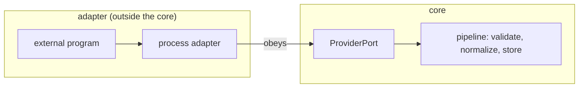
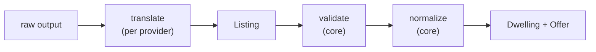
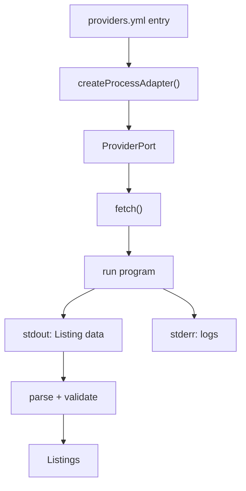

# Providers — core, port, adapter

The core must search housing sources it cannot know about. A **provider** is a
source of listings (Daft, MyHome, …). The core reaches providers only through a
**port**; a provider is realized by an **adapter** that obeys that port. This
keeps every source's messiness outside the hexagon.



## The boundary

The core and the outside meet at one data shape: the **interchange**
(`Listing`, "listing JSON v1"). Every provider must emit it. At the boundary
the core:

1. **validates** each `Listing` against `ListingSchema` — nothing crosses unchecked;
2. **normalizes** it into a `Dwelling` and an `Offer`.



Translation (raw output → `Listing`) is the only provider-specific step. Two
ways to do it, both leaving the third-party tool untouched:

- **A — the program translates:** a small wrapper script prints our JSON.
- **B — the mapping translates:** a `mapping` in config tells our adapter how
  to read the tool's own output.

## The port

A provider has an id, a country, the markets it serves, and a `fetch` that
streams listings. The core hands `fetch` a small context: an abort signal for
cancellation and timeout, a `pace` function that spaces requests, and a `log`
function. The adapter raises failures; the core validates, normalizes, and
dead-letters malformed output instead of crashing the run.

## Providers are user-side

This repo ships the **machinery** — the port, the process adapter, the registry,
`provider test`, and the `providers.yml` schema — not provider
implementations. A provider (its command plus config) lives in your workspace
(`providers.local/`, `config/providers.yml`) and is yours to write and
maintain; scrapers break often. The `add-provider` flow helps you create one.

## Adapter kinds

**Process adapter (primary).** Runs an external program and reads its **stdout**
as the interchange.



The contract is the Unix one: **stdout is data, stderr is logs.** The program
still runs fine by hand; wired as a provider, whatever it writes to stdout is
parsed as `Listing`.

```yaml
- id: daft
  type: process
  country: ie
  markets: [rent, buy]
  command: python3
  args: ["providers.local/daft.py"]
  env: { DAFT_COOKIE: "${DAFT_COOKIE}" }
  output: jsonl            # jsonl | json
  timeoutMs: 120000
```

Illustrative, not shipped: Daft via `daftlistings` needs its empty
`User-Agent`/`Origin`/`Referer` patched and prints progress to **stdout**, so a
wrapper must patch headers and send its logs to stderr.

**Module adapter.** TypeScript in `providers.local/`, obeying the same port in
code, for npm libraries or plain HTTP.

## Pacing and health

The core paces requests and never circumvents bot protection: a walled source
becomes `health: degraded`, not a bypass. Auth- or cookie-gated sources stay in
`providers.local/` and load only when enabled.

## Trying a provider

`provider test <id>` runs one provider on a capped sample and shows the
validated interchange — the loop for wiring a source. When it fails, the error
names the record that broke the contract.
