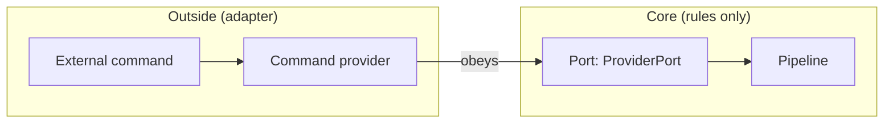
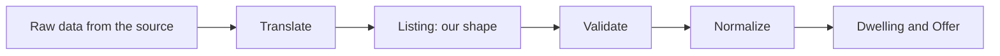
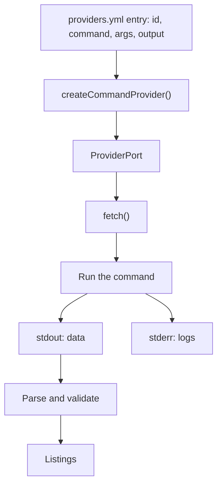
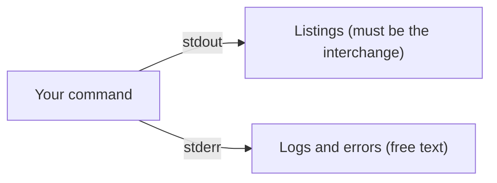
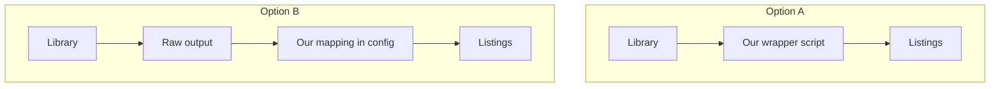

# Providers — a simple explanation

This document explains how housing-ops gets listings from websites.

## 1. The purpose

housing-ops must find houses.
The houses are on many websites.
Every website is different.
The core of housing-ops must not know these differences.
The core must understand one data shape only.
This document explains how we do this.

## 2. The words we use

- **core** — the part of the program that holds the rules. The core does not go on the network.
- **provider** — a part that gets listings from one source.
- **port** — a contract. A port says what a provider must do. Here the port is `ProviderPort`.
- **adapter** — code that obeys a port. Many adapters can obey one port.
- **command provider** — an adapter that runs an external command.
- **interchange** — the data shape for listings. We make this shape. Its name is "listing JSON version 1".
- **listing** — one record in the interchange. A listing is the data from one advertisement.
- **validate** — look at data and confirm the shape.
- **normalize** — change a listing into the objects `Dwelling` and `Offer`.
- **dwelling** — the physical place.
- **offer** — one advertisement for a dwelling.
- **boundary** — the line between the core and the outside.

## 3. The boundary

The core is in the middle.
The ports are at the edge of the core.
The adapters are outside the core.
An adapter obeys a port.
The core uses the port.
The core does not use the adapter directly.

## 4. The pipeline at the boundary

Data enters the core at the boundary.
The data passes through four steps.
Only two steps are generic.
The other two steps are different for every provider.

| Step | Job | Generic or provider-specific? | Built now? |
| --- | --- | --- | --- |
| Translate | Change raw data into a `Listing`. | Provider-specific | No |
| Validate | Confirm the `Listing` shape. | Generic | Yes |
| Normalize | Change the `Listing` into a `Dwelling` and an `Offer`. | Generic | Yes |
| (Fetch) | Get the raw data from the source. | Provider-specific | Yes, for commands |

## 5. The command provider

A command provider runs an external command.
The main rule is this: **the output of the command on stdout is the interchange.**
We call the output a `Listing`.

Steps of `fetch()`:

1. Wait for the pace limit.
2. Write a log line.
3. Run the command.
4. Read stdout.
5. Parse stdout as JSON. Each line is one listing. Or the whole output is one JSON array.
6. Validate each listing.
7. Give each listing to the pipeline.

## 6. The stdout rule

This rule is important.

- **stdout** carries the data. The data is the listing interchange.
- **stderr** carries logs and messages.

A user can run the command by hand.
If the command writes a table or a message on stdout, the provider fails.
The command must write its messages on stderr.

## 7. The translation: two options

Someone must change raw data into a `Listing`.
We have two options.
Both options keep the third-party library unchanged.

**Option A — the command translates.**
We write a small script.
The script uses the library.
The script prints listings on stdout.

**Option B — the mapping translates.**
We run the library as it is.
We write a small `mapping` block in the configuration.
Our adapter uses the mapping to make listings.

We did not choose an option yet.
We will choose after we look at the real output of the daft library.

## 8. What exists now, and what comes next

Exists now:

- The port `ProviderPort`.
- The command provider adapter. It runs a command, parses stdout, and validates the data.
- The interchange shape and its validation.
- Normalization: a `Listing` becomes a `Dwelling` and an `Offer`.

Not built yet:

- The translation for a real source.
- The registry. The registry reads `providers.yml`.
- The command `provider list`.
- The command `provider test`. This command runs a provider on a small sample and shows the result.
- The scan pipeline. This pipeline calls `fetch` and stores the results.
